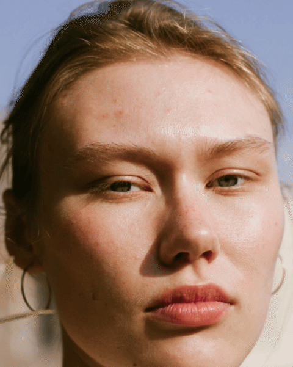
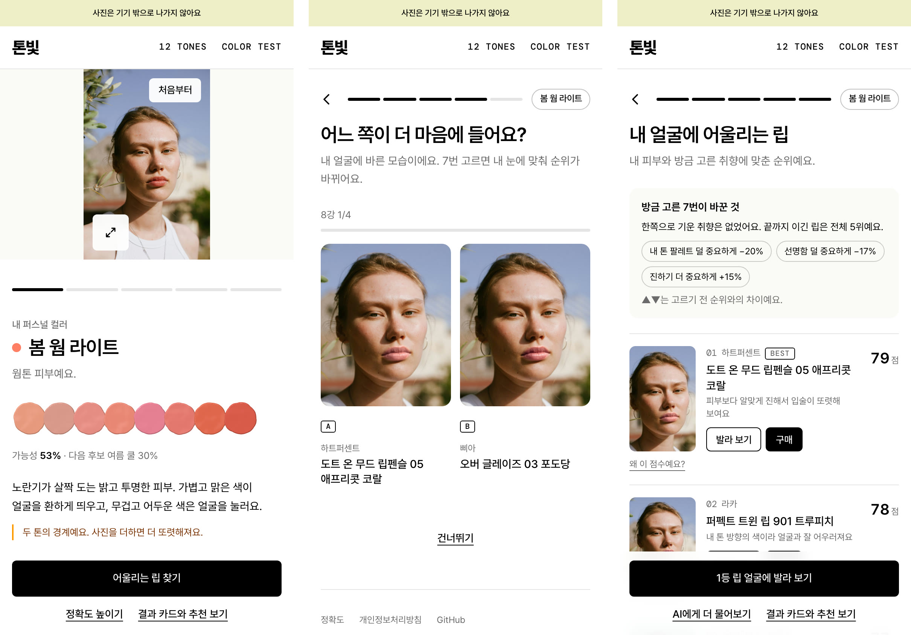
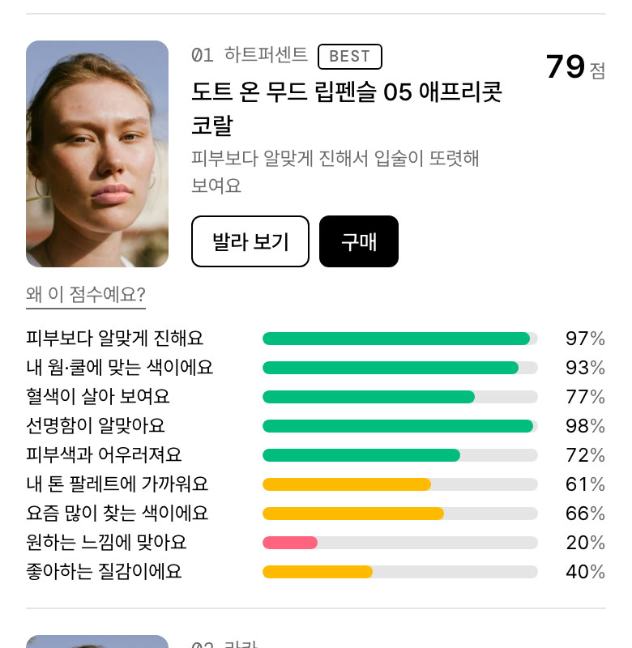

[톤빛](https://tonebit.vercel.app)은 셀카 한 장으로 웜·쿨과 12가지 시즌 톤을 가늠하고, 올리브영에서 잘 팔리는 립 196색 중 내 얼굴에 맞는 립을 골라 발라 보는 웹 서비스다. 얼굴 인식과 색 분석이 전부 브라우저 안에서 끝나고 사진은 어디로도 나가지 않는다.

10월 중순에 첫 버전을 올리고 3주 동안 세 번 크게 뜯어고쳤다. 왜 시작했고, 처음엔 뭘 만들었고, 뭘 고쳤고, 지금은 어떤 서비스가 됐는지 순서대로 적어 본다.

## 왜 만들었나

뷰티와 유통에 관심이 있다. 그 둘이 만나는 자리에 평소 관심 있던 퍼스널 컬러를 아이템으로 놓았다. 진단은 받아 보면 재미있는데 전문가 진단은 몇만 원에서 십만 원이 넘고, 온라인 자가 진단은 설문이라 얼굴을 보지 않는다.

만들고 싶었던 건 진단 자체보다 그 다음이었다. 돈을 들이지 않고 할 수 있는 만큼 정확하게 진단하고, 그 결과가 구매로 이어지는 것. 마케팅이든 서비스든 "이 톤이면 이 립"까지 가야 뷰티와 유통이 한 줄로 묶인다. 수익은 쿠팡 파트너스 링크로 내고, 운영은 무료 플랜 안에서 해결하기로 했다. MediaPipe가 브라우저에서 돌아가니 사진을 서버로 보내지 않고도 가능해 보였다.

## 처음 만든 것

아이디어를 내고 하루 만에 바이브 코딩으로 결과물을 만들어냈다. MVP를 따로 두지 않고 v1까지 한 번에 갔다. 공유 카드, 제휴 링크, CSP, E2E 테스트는 나중에 붙이면 구조가 바뀌는 것들이라 처음부터 넣었다.

MediaPipe로 얼굴을 찾고 볼과 이마 색을 읽어 웜·쿨과 네 시즌을 가르는 측정, 시즌 팔레트의 립과 블러셔를 사진 속 입술과 볼에 바로 얹어 보는 발라 보기, 톤마다 주소와 공유 썸네일이 있는 결과 페이지와 쿠팡 제휴 링크, 외부 연결을 막는 CSP와 가짜 카메라로 전체 흐름을 도는 Playwright 테스트까지 그날 다 넣었다. 저녁에는 12시즌 세부 타입과 "왜 이렇게 봤는지" 문장도 붙였다.

제품 데이터는 브랜드가 밝힌 색 설명을 보고 적은 근사치였고, 점수 같은 건 없었다. 시즌이 나오면 그 시즌 팔레트의 립을 발라 보는 게 전부였다.

배포하고 폰으로 열어 보니 그날 저녁에만 일곱 개를 고쳤다. iOS에서 wasm 경로가 틀려 모델이 안 뜨고, iPadOS가 데스크톱으로 잡히고, 색을 고르는 동안 사진이 화면 밖으로 밀려 나갔다. 모델 로딩에 진행률을 붙이고, 사진은 상단에 고정했다.

## 고치고 디벨롭한 것

### 1. 사진마다 시즌이 달랐다

같은 사람인데 사진마다 다른 시즌이 나왔다. 전문가 진단을 받아 본 지인에게 돌려 보니 절반쯤 맞았다.

"정확도를 올려 달라"는 요구는 "무엇과 비교해서"를 정해야 손댈 수 있다. 퍼스널 컬러에는 전문가가 드레이핑으로 판정한 공개 데이터가 없다. 그래서 맞혔는지는 못 재고, 잴 수 있는 두 가지를 쟀다. 동아시아인 얼굴에서 네 시즌이 고르게 나오는가, 같은 사진의 조명을 바꿔도 같은 답이 나오는가. FairFace 검증 세트의 동아시아인 1,281장(얼굴 인식 성공 1,176장)을 서비스의 측정 코드 그대로 헤드리스 브라우저에서 돌려 특징을 뽑고, 판정 실험은 Node에서 했다.

처음 배포한 기준값은 겨울이 38%로 쏠려 있었다. 기준값을 FairFace 분포의 중앙값으로 다시 잡자 봄 28%, 여름 22%, 가을 24%, 겨울 26%가 됐다. 조명을 되돌리는 방법도 바꿨다. 사진 전체 평균을 회색으로 가정하는 배경 보정은 어떤 변형으로도 사람 간 색상각 편차를 못 줄였다. 벽과 옷 색을 되돌리고 있었다. 대신 치아와 눈 흰자를 흰 기준으로 쓰는 방법(KAIST, Choi 외 2017)으로 바꾸고, 흰 종이가 있으면 그걸로 고정하는 길을 열었다. 조명 6종 변형에서 시즌이 같게 나오는 비율은 84.1%에서 86.8%로, 12톤은 64.3%에서 74.5%로 올랐다. 이 숫자는 정확도가 아니라 조명 견고성이다.

그러고 나서 논문을 뒤졌다. 셀카 한 장으로 네 시즌을 가르는 공개 최고치는 CNN이든 XGBoost든 52~56%에서 멈추고, 12시즌은 약 32%다. 한국 측색 연구에서 전문가가 웜·쿨로 나눈 집단의 볼 색상각 차이는 1~2°로 표본 편차보다 작았다. 방법이 달라도 같은 숫자에서 멈추는 건 정답 라벨 자체가 흔들린다는 뜻이다. 여기에 폰 카메라가 얼굴을 인식해 화이트밸런스를 피부 중심으로 맞추니, 재려는 언더톤을 카메라가 먼저 지운다.

여기서 방향을 정했다. 55%짜리 판정을 "진단"이라고 내놓지 않기로 했다. 시즌별 확률과 다음 후보를 같이 보여 주고, 왜 그렇게 봤는지 문장으로 풀고, 마지막 판정은 사용자의 눈에 맡긴다. 두 색을 번갈아 발라 보고 고르는 셀프 비교가 여기서 나왔다. 전문가 진단을 받아 본 이용자가 알려 주면 측정값과 함께 저장하고 매주 교차검증으로 기준값을 다시 찾는 루프도 이때 만들었다.

### 2. 어울린다는 립이 하나도 안 어울렸다

서비스 방향을 "내 립 찾기"로 잡고 올리브영 베스트셀러 90색을 넣어 어울림 점수를 매겼다. 그런데 내 얼굴로 돌려 보니 어울린다는 립이 하나도 안 어울렸다. 점수를 세 번 다시 만들었다.

**첫 번째** 점수는 연구에서 가져온 규칙을 그대로 옮긴 것이었다. 립은 피부보다 어두워야 하고, 색은 피부에서 너무 멀지 않아야 하고, 채도는 비슷해야 한다. 그런데 "이 정도면 됐다" 싶은 범위에 들어오면 전부 만점을 줘서 100점이 수두룩했다. **두 번째**는 딱 맞는 지점에서 멀어질수록 점수가 깎이게 바꿨다. 100점은 사라졌는데 여전히 안 어울렸다.

원인은 그 "딱 맞는 지점"이 사람마다 같았다는 데 있었다. 피부색이 전혀 다른 얼굴 셋에 돌려도 1·2등이 같은 중간 핑크였다. 웜인지 쿨인지, 밝은지 어두운지가 답을 가르지 않으니 웜톤이거나 딥한 사람에게는 맞을 수가 없었다.

**세 번째**는 "어떤 립이 좋은 립인가"의 기준점을 사람마다 다르게 잡았다. 쿨톤이면 핑크 쪽, 웜톤이면 코랄 쪽이 기준점이 되고, 라이트 타입이면 연한 립이, 딥 타입이면 진한 립이 기준점이 된다. 거기서 가까울수록 점수를 많이 받고 멀어질수록 깎인다. 비교는 제품 색 그대로가 아니라 "그 사람 입술에 발랐을 때 보일 색"으로 한다. 화면에 그릴 때 쓰는 계산을 그대로 쓰니까, 점수가 좋다고 한 색이 곧 화면에서 보이는 색이다.

점수를 매기는 기준은 열 가지다. 피부보다 얼마나 진한지, 웜·쿨 방향이 맞는지, 혈색이 살아 보이는지, 선명함이 알맞은지, 피부색과 어우러지는지, 내 톤 팔레트에 가까운지, 요즘 많이 찾는 색인지, 내가 답한 느낌에 맞는지, 좋아하는 질감인지, 치아가 하얘 보이는 색인지. 요즘 많이 찾는 색은 올리브영 월간 베스트 순위를 그대로 썼다.

바꾸고 나서는 피부색이 다른 얼굴 넷으로 전체 제품 점수를 뽑아 봤다. 네 얼굴의 1등이 체리 레드, 뮤트 로즈, 브릭 레드, 다크 피그로 전부 달랐고, 1등은 70점대 후반에서 80점대 중반, 중간은 60점 안팎이라 점수 차이가 눈에 보였다. 100점은 없다. 웜과 쿨의 상위 5개가 거의 안 겹치는지, 12타입의 1등이 서로 다른지는 테스트로 묶어 두어서 앞으로 점수를 손대도 지켜진다.

제품 데이터도 같이 늘렸다. 한국 브랜드 립 색을 무료로 주는 데이터는 없다. 그래서 브랜드 공식 사이트에 올라온 색상 칩과 발색 사진에서 색을 직접 뽑았다. 196색 중 173색이 이렇게 잰 값이고, 어디서 어떻게 쟀는지를 색마다 적어 뒀다. 쇼핑몰은 크롤링하지 않았다.

### 3. 발색이 스티커 같았다

립을 얹는 렌더링도 두 번 갈아엎었다. 처음에는 제품 색을 입술 위에 반투명하게 덮는 식이었는데 밝은 제품이 형광처럼 떴다. 색을 덜 올리자 이번엔 묽어지고, 입술의 반짝이는 부분까지 색이 입혀져 스티커를 붙인 것처럼 보였다. 지금은 세 가지를 따로 다룬다. 밝기는 제품 색 쪽으로 일부만 옮기고, 입술이 원래 갖고 있던 반짝임 자리에는 색을 덜 묻히고, 어두운 입술을 밝게 띄울수록 명암 폭을 같이 키워서 평평해지지 않게 한다. 값은 얼굴 세 장 × 제품 16색의 입 주변만 잘라 한 장에 늘어놓고 눈으로 보면서 정했다.

### 4. 내 선택을 배우게 했다

측정이 후보를 줄이고 판정은 사용자가 한다는 원칙을 제품 단위로 옮긴 게 "둘 중 고르기"다. 어울림 순위 상위에서 서로 충분히 다른 8색을 골라 내 얼굴에 바른 사진을 둘씩 보여 주고, 더 나은 쪽을 일곱 번 고르면 끝까지 이긴 립에 "내 1등"이 붙는다.

선택할 때마다 가중치를 다시 배운다. 내가 고른 쪽이 진 쪽보다 높은 점수를 받도록 열 가지 기준의 비중을 조금씩 옮기되, 원래 비중에서 너무 멀어지면 못 가게 붙잡는다. 처음엔 열 가지를 다 움직이게 했더니 일곱 번 고른 걸로 "치아 −70%" 같은 엉뚱한 결과가 나왔다. 일곱 번은 열 개를 정하기엔 너무 적은 정보라 우연에 맞춰진 것이다. 지금은 진하기, 웜·쿨 방향, 혈색, 선명함, 내 톤 팔레트 다섯 가지만 움직이고, 어떤 항목도 원래의 4분의 1 아래로는 안 내려간다. 대결표는 고르기를 시작할 때 정해 두어서, 선택할 때마다 순위가 바뀌어도 다음 대결이 흔들리지 않는다.

## 화면을 다시 짰다

기능이 늘어나는 동안 측정 뒤 화면은 쌓이기만 했다. 결과 탭과 발라 보기 탭, 셀프 비교, 립 월드컵 탭, 꼴찌와 1등 비교, 순위, 내 제품 색 재기, 전문가 진단 입력, AI 상담, 결과 반응이 한 화면에 있었다. 만든 내가 써 봐도 다음에 뭘 눌러야 하는지 몰랐다.

한 화면에 한 가지 일만 두기로 했다. 측정이 끝나면 다섯 단계로 간다.

1. 내 톤. 시즌과 확률, 다음 후보, 근거 문장. 버튼은 "어울리는 립 찾기" 하나.
2. 느낌. 자연스러운·화사한·또렷한 중 하나. 답에 따라 점수의 최적점이 움직인다.
3. 질감. 촉촉·보송·상관없음.
4. 둘 중 고르기. 내 얼굴에 바른 두 립 중 나은 쪽을 일곱 번. 건너뛸 수 있다.
5. 내 립. 순위와 발라 보기, 구매.

정확도 높이기(사진 추가, 흰 종이, 전문가 진단 입력)와 AI 상담은 주 흐름에서 빼서 곁가지 화면으로 뒀다.

만들면서 신경 쓴 게 세 가지 있다. 뒤로 가기는 브라우저 뒤로 가기와 같아야 했다. 단계가 바뀔 때마다 브라우저 히스토리에 한 칸씩 쌓아서, 폰에서 뒤로 스와이프하면 이전 단계로 돌아간다. 폰에서는 사진이 자리를 너무 많이 먹어서, 질문 화면에서는 아예 숨기고 내 톤 화면에서는 작게, 발라 보기에서만 위에 고정했다. 진행 막대와 다음 버튼은 화면 아래에 붙여서 엄지로 바로 닿는다. 그리고 둘 중 고르기에 나오는 얼굴은 서버 없이 폰 안에서 그린다. 측정이 끝난 사진 한 장을 들고 있다가 대결마다 두 제품을 바른 얼굴을 잘라서 보여 주고, 순위의 각 행에 붙는 얼굴도 같은 방식이다.

여기까지 만들고 나서 내가 처음부터 끝까지 써 봤다. 기능은 다 있는데 뭐가 뭔지 모르겠는 게 계속 걸렸다.

제일 먼저, 진단이 끝났는데 내 퍼스널 컬러가 뭔지 한눈에 안 들어왔다. 사진이 화면을 거의 다 차지하고 시즌 이름은 그 밑에 작게 있었다. 폰에서는 사진을 줄이고, 그 자리에 "내 퍼스널 컬러"라는 제목과 시즌 색 점, 웜톤인지 쿨톤인지 한 문장을 올렸다. 다음 화면부터는 오른쪽 위에 "봄 웜 라이트" 같은 작은 표시가 계속 따라다닌다.

둘 중 고르기를 일곱 번 하고 나서도, 이게 결과에 뭘 바꾼 건지 몰랐다. 그냥 순위가 나올 뿐이었다. 순위 맨 위에 "방금 고른 7번이 바꾼 것"이라는 상자를 뒀다. "더 진한 색을 골랐어요"처럼 내가 고른 경향을 한 줄로 말해 주고, "진하기 더 중요하게 +16%"처럼 뭐가 얼마나 더 중요해졌는지 보여 주고, 순위 옆에는 고르기 전과 비교해 몇 계단 오르내렸는지 ▲▼로 붙였다.

항목별 점수는 더 심했다. 막대가 작고 전부 검은색인 데다 항목 이름이 "치아", "인상"이었다. 치아가 뭔데? 사진에서 치아가 안 보이면 어떻게 되는데? 알고 보니 치아 항목은 사진 속 치아를 보는 게 아니라, 차갑고 선명한 립일수록 치아가 하얗게 보인다는 립 색의 성질이었다. 이름이 그렇게 읽히게 만든 게 문제였다. 항목 이름을 다 버리고 "피부보다 알맞게 진해요", "웃을 때 치아가 더 하얘 보이는 색이에요" 같은 문장으로 바꿨다. 막대는 키우고, 점수에 따라 초록·노랑·분홍으로 칠하고, 퍼센트를 붙였다. "왜 이 점수예요?"를 누르면 그 행 아래로 넓게 펼쳐진다.

그렇게 키운 막대가 꼴찌와 1등을 나란히 놓는 비교 화면에서는 깨졌다. 거기선 한 칸이 폰 폭의 절반이라 막대가 들어갈 자리가 없었다. 화면 폭이 아니라 칸 폭을 보고 배치를 바꾸는 컨테이너 쿼리로, 칸이 좁으면 문장 아래에 막대를 두게 했다.

마지막으로, 순위 상위를 인기 라인 하나가 색만 다르게 다 차지하는 경우가 있었다. 같은 제품은 두 색까지만 보이게 걸렀다. 둘 중 고르기에서 끝까지 이긴 내 1등만 예외다.

## 지금 모습

셀카를 올리면 내 톤이 확률과 함께 나오고, 느낌과 질감을 답하고, 내 얼굴에 바른 두 립 중 나은 쪽을 일곱 번 고르면, 196색 중 내 눈과 내 피부에 맞춘 순위가 나온다. 각 행에 그 립을 바른 내 얼굴과 구매 링크가 붙고, 1등을 얼굴에 발라 볼 수 있다. 이 모든 게 폰 브라우저 안에서 끝난다.

- 립 데이터: 196색, 42개 브랜드, 79개 라인. 173색은 공식 칩·발색에서 잰 값.
- 점수: 열 각도, 사람마다 다른 최적점, 선택으로 배우는 가중치.
- 흐름: 측정 뒤 다섯 단계, 곁가지 둘.
- 테스트: Vitest 단위·분포 테스트, Playwright E2E(가짜 카메라), 통합(pgvector + 모의 Gemini), Docker 빌드. CI는 이 넷이 다 초록이어야 한다.

기술 스택은 Next.js 16, React 19, TypeScript, Tailwind v4, Zustand, MediaPipe Face Landmarker, Postgres + pgvector, Gemini, Vitest, Playwright, GitHub Actions이다.

## 돌아보면

- "정확도를 올려 달라"는 말을 "무엇과 비교해서"로 바꾸고 나서야 손을 댈 수 있었다. 비교 대상이 없어서 분포와 조명 견고성을 쟀고, 문헌에서 천장을 확인한 하루가 모델을 만지작거렸을 몇 주를 아꼈다.
- 점수 함수는 이제 바꾸기 전에 제품 전체 × 얼굴 넷의 분포부터 찍는다. 첫 점수는 분포를 안 보고 올려서 100점이 수두룩했고, 두 번째는 분포가 예뻐도 안 어울렸다.
- 기능을 더하는 것보다 한 화면에서 빼는 게 어려웠다. 탭 넷을 단계 다섯으로 펴고 나서야 다음에 뭘 눌러야 할지 보였다.
- "치아 4%"는 아무 뜻이 없었고 "웃을 때 치아가 더 하얘 보이는 색이에요"는 뜻이 있었다. 설명 문구는 전부 이렇게 바꿨다.
- 직접 써 보고 "뭔지 모르겠다"고 느낀 지점이 그대로 다음 커밋이 됐다.

다음은 근사치가 남은 23색과 발색 사진에서 잰 색을 실물로 재서 바꾸는 것, 바르기 전·후 사진으로 렌더링의 덮임을 맞추는 것, 전문가 진단 피드백을 모아 재보정 루프를 실제로 돌리는 것이다.

## 참고

- Kärkkäinen, K., & Joo, J. (2021). FairFace. WACV.
- Choi, K., Choi, J., & Suk, H.-J. (2017). The human sclera and pupil as the calibration targets. IS&T Electronic Imaging.
- Hirayama, H. 외 (1998). 립 컬러와 피부색의 조화에 관한 연구. 粧技誌 32(2).
- Ou, L.-C., & Luo, M. R. (2006). A colour harmony model for two-colour combinations. Color Research & Application 31(3).
- 코드와 수치 전체: [github.com/OHaEuN/tonebit](https://github.com/OHaEuN/tonebit)의 `docs/color-analysis.md`, `docs/lip.md`.
