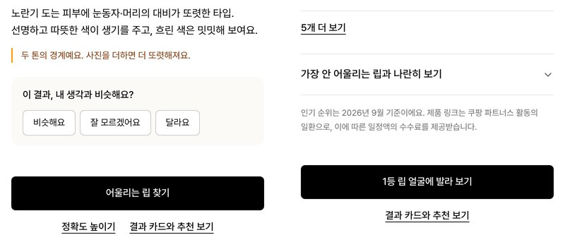

[지난 글](/31)에서 톤빛을 하루 만에 만들고 3주 동안 어떻게 바꿔 왔는지 적었다. 그 글을 포트폴리오에 붙이려고 다시 읽어 보니 코드와 회고는 있는데, 정작 "왜 이렇게 정했는지"를 적어 둔 문서가 없었다. 팀에서 일할 때는 기획자가 시장조사부터 화면설계서까지 먼저 써 두고 그 위에서 개발이 돌아가는데, 혼자 만들다 보니 그 단계를 통째로 건너뛴 것이다.

그래서 이번에는 반대로 해 봤다. 이미 돌아가고 있는 서비스를 보면서, 기획자였다면 썼을 문서를 하나씩 채웠다. 사후에 쓴 문서라는 건 문서 첫 줄에 적어 두었다. 쓰는 데 하루가 걸렸고, 그 하루 동안 서비스에 빠져 있던 것 아홉 가지가 나왔다.

> **결과:** 기획 문서 여덟 편(시장조사, 서비스 기획서, 요구사항 정의서, 정책서, 정보구조와 흐름, 화면설계서, 지표와 이벤트 설계, 출시·운영 계획)을 썼다. 쓰면서 빠진 것 아홉 가지를 찾았고 그중 다섯 가지는 그날 고쳐서 배포했다. 서비스를 실제로 바꾼 문서는 정책서와 지표 설계 두 편이었다.

문서는 저장소의 [docs/planning](https://github.com/OHaEuN/tonebit/tree/master/docs/planning)에 올려 두었다.

---

## 1. 무엇을 썼나

| 문서 | 어떤 질문에 답하나 |
|---|---|
| 사전 시장조사 | 이 시장에 들어갈 이유가 있나, 누가 이미 하고 있나 |
| 서비스 기획서 | 누구의 어떤 문제를 어떻게 풀고, 성공은 무엇으로 재나 |
| 요구사항 정의서 | 무엇을 꼭 만들고 무엇은 안 만드나 |
| 서비스 정책서 | 애매한 상황에서 서비스가 어떻게 판단하나 |
| 정보구조와 사용자 흐름 | 화면이 어떻게 이어지고 어디서 갈라지나 |
| 화면설계서 | 각 화면에 무엇이 있고 눌렀을 때 무슨 일이 나나 |
| 지표와 이벤트 설계 | 잘 되고 있는지 무엇으로 알고 어떻게 남기나 |
| 출시·운영 계획 | 언제 무엇을 확인하고 내보내며, 무엇이 위험한가 |
{: data-ke-align="alignLeft"}

시장조사의 숫자는 출처 페이지를 직접 열어 확인한 것만 적었다. 오프라인 진단이 4만 원대에서 시작해 평균 6만 원대라는 것, 한 예약 플랫폼에서는 외국인 손님의 뷰티숍 결제 가운데 80%가 퍼스널 컬러 진단이었다는 것, 올리브영이 올해 안에 피부 진단 앱에 퍼스널 컬러를 넣는다는 것. 이 셋을 놓고 보면 업계가 진단에서 구매로 이어지는 쪽으로 가고 있고, 집에서 무료로 그 흐름을 끝까지 해 주는 서비스는 아직 없다. 톤빛은 그 자리를 보고 만든 셈이라, 시장조사는 쓰면서 방향을 다시 확인하는 정도였다.

나머지 일곱 편은 이미 있는 서비스를 문서로 옮겨 적는 일에 가까웠다. 그런데 옮겨 적다 보니 문서에는 써 놓고 서비스에는 없는 것이 자꾸 나왔다.

---

## 2. 쓰면서 걸린 것

| 어느 문서에서 | 무엇이 걸렸나 |
|---|---|
| 지표 설계 | 퍼널을 여섯 단계로 적어 놓고 실제 이벤트는 측정 완료와 구매 클릭뿐이었다. 그 사이 네 단계에서 어디서 빠져나가는지 볼 방법이 없었다 |
| 정책서 | "구매 링크가 있는 화면에는 모두 파트너스 고지를 둔다"고 쓰고 화면을 열어 보니, 발라 보기 화면에는 고지가 없었다 |
| 정책서 | "인기 순위는 분기마다 갱신한다"고 썼는데, 보는 사람은 그 순위가 언제 것인지 알 길이 없었다 |
| 기획서 | 목표 "결과를 믿을 수 있다"를 재는 지표가 체감 일치율인데, 그걸 묻는 카드가 정확도 높이기 화면에만 있었다. 거기까지 들어온 사람의 답만 모인다 |
| 출시 계획 | 아이폰 사진 회전은 실기기로 한 번 눌러 본 게 확인의 전부였다 |
| 화면설계서 | 공유되는 결과 카드가 톤별 공용이라 내 1등 립이 들어가지 않는다 |
| 시장조사 | 수요가 가장 큰 쪽이 외국인인데 서비스는 한국어뿐이다 |
| 지표 설계 | 목표로 적은 숫자가 전부 가설이다 |
| 요구사항 | 접근성을 "완료"라고 써 놓고 검사 도구를 돌린 적이 없다 |
{: data-ke-align="alignLeft"}

앞의 다섯 가지는 하나씩 한두 시간이면 되는 일인데 3주 동안 한 번도 안 했다. 기능을 만들 때는 그 기능만 보게 되고, 고지가 빠졌는지나 순위가 언제 것인지 같은 건 누가 물어보기 전에는 생각이 나지 않았기 때문이다. 문서를 쓰는 일이 그 질문을 대신 해 준 셈이다.

---

## 3. 그날 고친 것

### 화면이 바뀔 때마다 이벤트를 보낸다

측정이 끝난 뒤 화면이 바뀔 때마다 어느 화면인지 보내는 이벤트를 넣었다. 내 톤, 느낌, 질감, 둘 중 고르기, 순위, 발라 보기, 정확도 높이기, AI 상담까지 전부 남는다. 측정 완료 이벤트에는 사진 몇 장을 합쳤는지도 같이 보내게 했다. 사진 장수와 확신도가 어떤 관계인지는 4주쯤 쌓이면 볼 수 있을 것 같다.

### 발라 보기 화면에도 파트너스 고지

정책서에 고지 규칙을 쓰고 나서 화면을 하나씩 열어 보니 순위 화면에는 있고 발라 보기 화면에는 없었다. 고지 문단을 컴포넌트 하나로 빼서 두 화면이 같은 걸 쓰게 했다. 앞으로 구매 링크가 있는 화면이 늘어도 이 컴포넌트만 넣으면 된다.

### 순위에 기준 시점을 적는다

순위 데이터는 분기마다 손으로 갱신하는데 화면에는 그게 언제 것인지 적혀 있지 않았다. 적지 않으면 보는 사람은 지금 순위로 읽는다. 순위 화면 아래에 "인기 순위는 2026년 9월 기준이에요" 한 줄을 넣고, 날짜는 상수로 두어 데이터를 갱신할 때 같이 바꾸도록 했다.

### 반응 카드를 내 톤 화면으로 옮겼다

"이 결과, 내 생각과 비슷해요?"라고 묻는 카드가 정확도 높이기 화면에만 있었다. 거기까지 들어오는 사람은 결과가 미심쩍어서 온 경우가 많을 테니, 그 답만 모으면 정확도가 실제보다 낮게 잡힌다. 측정을 끝낸 사람이 모두 보는 내 톤 화면으로 옮겼다. 지난 글에서 화면마다 글을 줄였던 걸 생각하면 주 화면에 질문을 하나 더하는 게 마음에 걸렸지만, 쓸 수 있는 숫자를 얻는 쪽이 낫다고 봤다. 전문가 진단 입력은 그대로 정확도 높이기에 두고, 달라요를 누르면 그리로 이어지게 했다.

<figure class="imageblock alignCenter" markdown="1">

</figure>

### 눕혀 저장된 사진을 테스트에 넣었다

폰으로 찍은 사진은 픽셀은 눕혀 저장하고 EXIF에 회전 정보만 적는 경우가 많다. 지금까지는 아이폰 실기기로 한 번 확인하고 넘어갔는데, 그런 사진을 픽스처로 만들어 올리면 세로로 세워서 측정하는지 E2E 테스트에 넣었다. 브라우저의 기본 회전 처리에 맡기는 설계라 코드는 바뀐 게 없고 테스트만 늘었다.

---

## 4. 미룬 것

| 항목 | 왜 미뤘나 | 언제 하나 |
|---|---|---|
| 결과 카드에 내 1등 립 넣기 | 서버에서 그리는 카드가 톤별 공용이라 구조를 바꿔야 한다 | 공유율이 3%를 넘으면 |
| 영어 | 수요는 외국인이 가장 크지만 지금 유입이 없다 | 해외 유입이 잡히면 |
| 지표 목표 숫자 | 측정 완료율 60%, 구매 클릭 5% 같은 숫자가 전부 가설이다 | 4주 뒤 실제 값으로 바꾼다 |
| 접근성 검사 | 요구사항에 "완료"라고 써 놓고 검사 도구를 돌린 적이 없다 | 상태를 "확인 필요"로 고쳤고, axe를 돌리는 게 다음 일이다 |
{: data-ke-align="alignLeft"}

---

## 5. 어떤 문서가 쓸모 있었나

빠진 걸 찾아낸 건 거의 정책서와 지표 설계였다. 기획서와 화면설계서는 있는 화면을 보고 옮겨 적으면 끝났다. 정책서는 "이 경우에는 이렇게 한다"를 한 줄씩 써야 해서 정해 두지 않은 게 바로 드러났고, 지표 설계는 "이 숫자는 어떤 이벤트로 재나"를 쓰다 보면 이벤트가 없는 게 보였다.

> 판단 기준: **쓰고 나서 서비스가 바뀐 게 없는 문서는 다음 프로젝트에서는 건너뛴다.**
{: data-ke-style="style1"}

다음에 사이드 프로젝트를 또 한다면 여덟 편을 다 쓰지는 않을 것 같다. 정책서와 지표 설계 두 편은 만들기 전에 쓰고, 나머지는 만든 뒤에 필요하면 채우는 정도가 혼자 하는 프로젝트에는 맞는 것 같다. 처음부터 여덟 편을 썼다면 첫 버전이 하루 만에 나오지는 않았을 것이다.

## 마치며

문서 없이 3주를 고쳤는데, 문서 쓰는 데 하루를 쓰고 나니 다섯 가지가 더 고쳐졌다. 개인적으로는 반응 카드를 내 톤 화면으로 옮긴 게 가장 잘한 결정이라고 생각한다. 이게 있어야 정확도 이야기를 숫자로 할 수 있기 때문이다.

다음은 4주 뒤에 퍼널 숫자를 보는 일이다. 가설로 적어 둔 측정 완료율 60%, 구매 클릭 5%가 실제로 얼마였는지, 그래서 무엇을 바꿨는지를 다음 글에 적으려고 한다.
